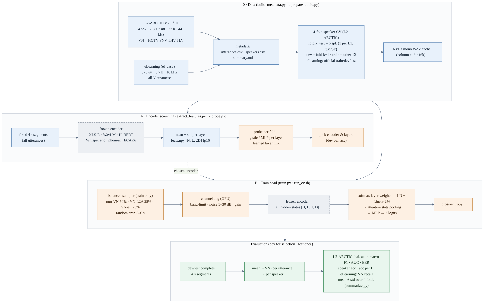

# L2-English accent classifier (Vietnamese vs. non-Vietnamese)

Frozen pretrained speech encoder → learned layer mix → attentive statistics pooling → MLP → 2 classes
(`1 = vietnamese`, `0 = non_vietnamese`).



## Data

| corpus | speakers | utts | hours | label | split |
|---|---|---|---|---|---|
| L2-ARCTIC v5.0 full (`<SPK>/wav/*.wav`) | 24 = 6 L1 × (2 M + 2 F) | 26,867 | 27.1 | 1 for HQTV, PNV, THV, TLV | 4-fold speaker CV |
| eLearningMDD el_easy | official splits | 373 | 3.7 | 1 (all Vietnamese) | official train/dev/test in every fold |

Fold *k*: **test** = the 6 L2-ARCTIC speakers of fold *k* (1 per L1, 3 M / 3 F), **dev** = fold *k+1*,
**train** = the other 12. Class balancing only in the training sampler; dev/test are complete.
Primary metric: balanced accuracy on L2-ARCTIC (mean ± std over 4 folds); eLearning VN recall separately.

Shortcut guards: everything resampled to 16 kHz; random 3–6 s crops (eLearning utterances are ~35 s,
L2-ARCTIC ~3.6 s); channel augmentation (band-limit, noise, gain); eLearning-free ablation
(`--train_corpora l2arctic`).

## Layout

```
scripts/build_metadata.py   find audio, speaker table, 4 folds, summary.md
scripts/prepare_audio.py    one-off 16 kHz mono WAV cache (+ column audio16k in the metadata)
scripts/extract_features.py stage A: frozen encoder -> mean+std of every layer per 4 s segment
scripts/probe.py            stage A: linear / MLP probe per layer + learned layer mix, 4 folds
scripts/train.py            stage B: train the head (one fold)
scripts/run_cv.sh           stage B on folds 0-3 + summary
scripts/summarize.py        mean ± std tables of all runs and probes
src/accent/                 audio, data (sampler, crops, augmentation), encoders, model, metrics
```

Encoders (`--encoder`): `xlsr300m`, `wavlm_large`, `hubert_large`, `wav2vec2_large`, `whisper_small`,
`whisper_medium`, `ecapa` (needs `pip install speechbrain`), `hf:<id|dir>`, `whisper:<id|dir>`,
`phonrec:<checkpoint file|dir>` (our phoneme-recognition checkpoints; the XLS-R weights are found in
the state dict whatever the key prefix).

## Commands

```bash
python3 -m venv .venv && .venv/bin/pip install -r requirements.txt

# 0. metadata + 16 kHz cache (re-run prepare_audio after every build_metadata; existing wavs are skipped)
.venv/bin/python scripts/build_metadata.py --l2arctic_root <L2-ARCTIC> --el_train ... --el_dev ... --el_test ... --out_dir metadata
.venv/bin/python scripts/prepare_audio.py --metadata metadata --out_dir <16k cache dir>

# A. encoder screening
.venv/bin/python scripts/extract_features.py --encoder wavlm_large
.venv/bin/python scripts/probe.py --features features/* --weighted

# B. full head, 4 folds
bash scripts/run_cv.sh wavlm_large wavlm_asp
.venv/bin/python scripts/summarize.py
```

Outputs: `features/<enc>/`, `results/probe/<enc>/`, `runs/<run>/fold<k>/{train.log,history.json,best.pt,
metrics.json,pred_dev.csv,pred_test.csv}`. GPU memory is capped with `--gpu_memory_fraction` (default 0.5).
